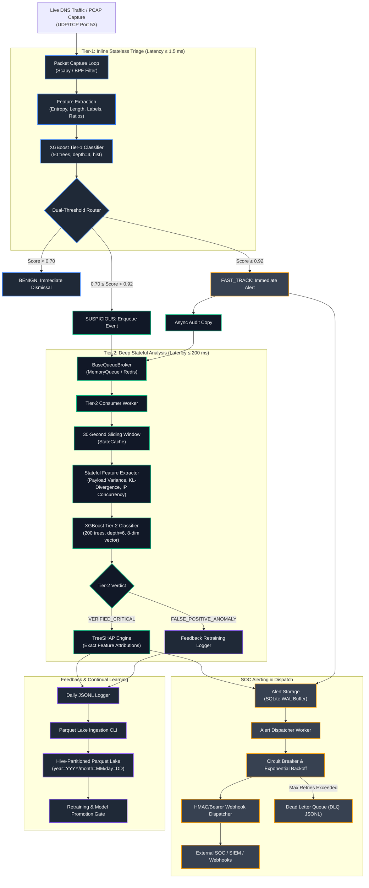

# Vespera IDS — Comprehensive Architecture Specification

## 1. Executive Summary & Design Principles

**Vespera IDS** is a production-grade, two-tier network intrusion detection system purpose-built to detect and disrupt DNS tunneling attacks in real time. DNS tunneling abuses the Domain Name System protocol (UDP/TCP port 53) to establish bidirectional Command and Control (C2) channels, bypass captive portals, or exfiltrate sensitive data encoded within domain query labels.

The architecture of Vespera IDS is grounded in four foundational engineering principles:

1. **Asymmetric Latency Budgets**: Network packet ingestion cannot be blocked by heavyweight feature extraction. We divide detection into a microsecond-scale stateless triage stage ($\le 1.5\text{ ms}$) on the hot path and an asynchronous, multi-query stateful analysis stage ($\le 200\text{ ms}$) off the hot path.
2. **Explainability First (XAI)**: A classification score alone is insufficient for security operations. Every confirmed alert is accompanied by per-feature Shapley attribution values (via TreeSHAP), allowing SOC analysts to immediately understand why an anomaly was flagged.
3. **Defense-in-Depth & Non-Blocking Fast-Track**: Blatant high-confidence attacks bypass asynchronous queueing to fire immediate alerts, while ambiguous anomalies undergo sliding-window enrichment.
4. **Resilience & Zero Loss**: External webhook failures, process crashes, or network partitions must not cause alert loss or system lockup. All alerts are buffered to a write-ahead logged (WAL) SQLite datastore before transmission, guarded by exponential backoff and a 3-state circuit breaker.

---

## 2. High-Level Architecture & End-to-End Flow



---

## 3. Subsystem Breakdown

### 3.1 Packet Capture & Ingestion Engine (`packet_capture.py`, `main.py`)
- **Ingestion Mechanisms**: Captures DNS packets via Scapy's `AsyncSniffer` or socket loop, filtered with BPF string `udp port 53 or tcp port 53`. Supports live network interfaces (e.g. `eth0`) and offline `.pcap` files.
- **Process Supervision**: In production, the main process (`main.py`) acts as a process supervisor, isolating Tier-1 ingestion from Tier-2 workers.
- **CPU Affinity Optimization**: On Linux, Tier-1 ingestion is pinned to dedicated physical CPU cores (e.g., `0,1`) using `os.sched_setaffinity` to avoid kernel context-switching latency.

### 3.2 Tier-1 Fast Inline Triage Subsystem (`tier1_triage.py`)
- **Role**: Operates directly on the packet capture hot path. Computes lightweight stateless features from individual queries and computes a preliminary anomaly probability score $P_{\text{T1}}$.
- **Feature Set**:
  1. `fqdn_length` ($\text{int}$): Total character length of the query name.
  2. `subdomain_count` ($\text{int}$): Number of label separators (dots).
  3. `shannon_entropy` ($\text{float}$): Shannon entropy of the query string:
     $$H = -\sum_{i=1}^{n} p(c_i) \log_2 p(c_i)$$
  4. `numeric_alpha_ratio` ($\text{float}$): Ratio of numeric digits to alphabetical characters:
     $$\text{ratio} = \frac{\text{count}(\text{digits})}{\max(1, \text{count}(\text{alpha}))}$$
- **Model Topology**: Shallow XGBoost classifier (`max_depth=4`, `n_estimators=50`, `tree_method='hist'`).
- **SLA & Budget**: Execution time strictly $\le 1.5\text{ ms}$ per packet; throughput target $\ge 50,000\text{ QPS}$.

### 3.3 Dual-Threshold Routing Layer (`router.py`)
- **Routing Decision Matrix**:
  - $P_{\text{T1}} < 0.70$ $\rightarrow$ **`BENIGN`**: Query is silently discarded without logging or memory allocation.
  - $0.70 \le P_{\text{T1}} < 0.92$ $\rightarrow$ **`SUSPICIOUS`**: Query metadata and stateless feature vectors are packaged into a JSON-serializable event payload and pushed to the Tier-2 queue.
  - $P_{\text{T1}} \ge 0.92$ $\rightarrow$ **`FAST_TRACK`**: An immediate SOC alert is generated and dispatched to `AlertStorage` *before* an asynchronous audit copy is enqueued to Tier-2. Tier-2 analysis enriches the audit trail but never gates this alert.

### 3.4 Decoupled Queue Broker Infrastructure (`queue_broker.py`, `memory_queue.py`, `redis_queue.py`)
- **Broker Abstraction**: Defines `BaseQueueBroker`, enforcing `enqueue()`, `dequeue()`, `qsize()`, and `is_healthy()` contracts.
- **`MemoryQueueProvider`**: In-process FIFO queue utilizing Python's `multiprocessing.Queue`. Zero external dependencies, ideal for single-node edge appliances and local evaluation.
- **`RedisQueueProvider`**: Distributed FIFO queue utilizing Redis `LPUSH` / `BRPOP` primitives. Enables horizontal scaling across multi-probe capture clusters.
- **Backpressure & Disk Spillover**: If the queue reaches `max_size` (default: 10,000 items), incoming events are non-blockingly spilled to an append-only disk log (`queue_overflow.log`) to preserve Tier-1 line-rate guarantees.

### 3.5 Tier-2 Stateful Deep Analysis Subsystem (`tier2_analysis.py`, `state_cache.py`, `queue_consumer.py`)
- **Role**: Asynchronous, multi-worker consumer that correlates queries across a 30-second sliding temporal window.
- **State Window Cache (`StateCache`)**: Thread-safe in-memory cache keyed by `(parent_domain, client_ip)`. Prunes entries older than 30 seconds upon every update.
- **Feature Vector (8 Dimensions)**:
  - *Inherited Tier-1 Features*: `fqdn_length`, `subdomain_count`, `shannon_entropy`, `numeric_alpha_ratio`.
  - *Incremental Stateful Features*:
    1. `record_type_heterogeneity`: Ratio of TXT, CNAME, and AAAA queries to total queries within the window.
    2. `payload_variance`: Sample variance of sequential query payload byte lengths.
    3. `ngram_transition_score`: Kullback-Leibler (KL) divergence between the observed 2-gram character transition distribution of query labels and a precomputed baseline:
       $$D_{\text{KL}}(P \parallel Q) = \sum_{x \in \mathcal{X}} P(x) \log_2 \left(\frac{P(x)}{Q(x)}\right)$$
    4. `unique_ip_concurrency`: Count of distinct client IPs querying the same anomalous parent domain within the window.
- **Model Topology**: Deep XGBoost classifier (`max_depth=6`, `n_estimators=200`, `tree_method='hist'`).
- **Verdicts**:
  - `VERIFIED_CRITICAL`: Triggers TreeSHAP calculation and dispatches a verified high-priority alert.
  - `FALSE_POSITIVE_ANOMALY`: Bypasses SOC alerting; routed directly to the continual learning feedback pipeline.

### 3.6 Explainable AI (XAI) Engine (`TreeSHAP`)
- **Technology**: Implemented using `shap.TreeExplainer` on the 8-feature tree ensemble.
- **Asynchronous Execution**: Executed strictly in Tier-2 workers off the hot path.
- **Attribution Format**: Generates exact Shapley values indicating how each individual feature shifted the model's base probability toward or away from the malicious verdict. Output is embedded in the alert payload:
  ```json
  "shap_attributions": {
    "shannon_entropy": 0.412,
    "payload_variance": 0.328,
    "ngram_transition_score": 0.185,
    "fqdn_length": 0.089
  }
  ```

### 3.7 Resilient SOC Alerting & Dispatch Pipeline (`alert_storage.py`, `alert_dispatcher.py`)
- **Local SQLite WAL Buffer**: Every alert is staged locally in SQLite with `PRAGMA journal_mode=WAL` and `PRAGMA synchronous=NORMAL`. Survived process terminations and host restarts.
- **State Machine**: Alerts transition through `PENDING` $\rightarrow$ `SENDING` $\rightarrow$ `DELIVERED` or `FAILED_DLQ`.
- **Exponential Backoff**: Retries are scheduled with exponential backoff plus uniform jitter:
  $$\text{delay} = \min\left(\text{retry\_max}, \text{retry\_base} \cdot 2^{\text{retry\_count}}\right) \pm \text{jitter}$$
- **Three-State Circuit Breaker**:
  - `CLOSED`: Normal operation.
  - `OPEN`: Triggered after 3 consecutive dispatch failures. Halts outbound network traffic for 60 seconds to prevent thundering herds against failing SIEM endpoints.
  - `HALF_OPEN`: Allows a single probe request to verify endpoint recovery.
- **Defensive SSRF Hardening**: Target webhook URLs are checked before connection. Private subnets (RFC 1918), loopback addresses (127.0.0.0/8), and link-local ranges (169.254.0.0/16) are rejected unless `allow_insecure_local_webhooks` is explicitly configured.
- **Dead-Letter Queue (DLQ)**: Alerts that exhaust max retries (5) are written to `data/logs/failed_alerts.jsonl` and tracked in `alert_dispatch_dropped_total`.

### 3.8 Continual Learning & Data Lake Pipeline (`feedback_logger.py`, `parquet_lake.py`)
- **Daily Event Logging**: Feedback logger captures queries, feature arrays, triage scores, and ground truth labels into daily append-only files (`data/feedback/events_YYYY-MM-DD.jsonl`).
- **Hive Columnar Partitioning**: A scheduled ETL pipeline parses daily logs, enforces column schemas, and writes compressed Snappy/Parquet partitions:
  `data/parquet_lake/year=YYYY/month=MM/day=DD/events.parquet`
- **Analytics Ready**: Enables partition-pruned querying via DuckDB, Pandas, or PySpark for recurring retraining runs.

### 3.9 Model Governance & Promotion Pipeline (`model_promotion.py`, `prepare_and_train.py`)
- **Automated Performance Gates**: Every newly trained model candidate must satisfy mandatory acceptance thresholds against golden validation sets and a 14-day rolling evaluation set:
  - **Tier-1**: Recall $\ge 99.5\%$, Latency regression $\le 0\%$.
  - **Tier-2**: Precision $\ge 98.0\%$, False Positive Rate (FPR) degradation $< 0.1\%$.
  - **Latency SLA**: Any overall latency regression $> 5\%$ results in immediate rejection.
- **48-Hour Shadow Inference**: The candidate model runs concurrently with the production model against live replayed traffic, logging hypothetical verdicts without triggering SOC alerts.
- **Atomic Symlink Deployment**: Models are referenced via symlinks (`models/xgboost_tier1_active.json`). Promotions atomically swap symlinks via `os.replace` on Linux/macOS or copy-then-rename on Windows, providing zero-downtime hot reloading and sub-millisecond rollbacks.

### 3.10 Presentation & User Interfaces (`app.py`, `dashboard.py`, `index.html`)
- **Streamlit Web Dashboard (`app.py`)**: Hosted interactive interface providing real-time domain testing, dual-tier scoring gauges, interactive TreeSHAP waterfall charts, preset attack simulations, and live log inspection.
- **Terminal UI (`dashboard.py`)**: Terminal user interface built with `rich` for headless server monitoring, displaying throughput gauges, queue depths, and real-time alert logs.

---

## 4. Subsystem Performance Budgets & SLAs

| Subsystem | Latency Budget | Target Throughput | Failure Mode Strategy |
|---|:---:|:---:|---|
| **Tier-1 Feature Extraction** | $\le 0.5\text{ ms}$ | $\ge 50,000\text{ QPS}$ | Fallback to default scalar values |
| **Tier-1 Model Inference** | $\le 1.0\text{ ms}$ | $\ge 50,000\text{ QPS}$ | Pinned CPU execution; hist tree method |
| **Tier-1 Total Budget** | $\le 1.5\text{ ms}$ | $\ge 50,000\text{ QPS}$ | Skip packet on buffer overflow |
| **Queue IPC Transit** | $\le 5.0\text{ ms}$ | Scalable | Spill to `queue_overflow.log` |
| **Tier-2 State Accumulation** | $\le 20.0\text{ ms}$ | $\ge 2,500\text{ EPS}$ | Auto-pruning 30-second sliding window |
| **Tier-2 Model Inference** | $\le 50.0\text{ ms}$ | $\ge 1,000\text{ EPS}$ | Multi-worker parallel processing |
| **TreeSHAP Attribution** | $\le 125.0\text{ ms}$ | $\ge 500\text{ EPS}$ | Fallback to raw feature vector output |
| **Tier-2 Total Budget** | $\le 200.0\text{ ms}$ | $\ge 1,000\text{ EPS}$ | Asynchronous execution off hot path |
| **Alert Staging (SQLite WAL)** | $\le 2.0\text{ ms}$ | $\ge 10,000\text{ EPS}$ | WAL mode with local thread locking |
| **Webhook HTTP Dispatch** | $100\text{ ms} - 5\text{ s}$ | Asynchronous | Exponential backoff + Circuit breaker |

---

## 5. Security & Defensive Hardening

1. **SSRF Prevention**: The alert dispatcher validates all webhook URLs with `ipaddress` parsing. Delivery to private IP blocks (`10.0.0.0/8`, `172.16.0.0/12`, `192.168.0.0/16`), loopback (`127.0.0.1`), link-local (`169.254.0.0/16`), and IPv6 counterparts is blocked by default.
2. **Cryptographic Webhook Signatures**: In addition to Bearer tokens, the dispatcher supports HMAC-SHA256 request signing via the `X-Signature-SHA256` HTTP header, ensuring tamper-proof delivery to downstream SOAR systems.
3. **Queue Flooding Protection**: If an adversary attempts to exhaust sensor RAM by generating high volumes of suspicious queries, the queue enforces a strict `max_size` boundary. Overflow traffic is appended to disk, preventing process Out-of-Memory (OOM) crashes.
4. **Symlink Hijack Protection**: The model promotion pipeline validates file ownership, model JSON schemas, and hashes before initiating atomic symlink replacement.

---

## 6. Configuration Management

All operational thresholds, hyper-parameters, and subsystem paths are centrally declared in `config.py` and configurable via environment variables prefixed with `DNS_`:

| Config Class | Environment Variable | Default Value | Description |
|---|---|:---:|---|
| `Tier1Config` | `DNS_T1_P_BENIGN_MAX` | `0.70` | Upper probability threshold for benign dismissal |
| `Tier1Config` | `DNS_T1_P_FASTTRACK_MIN` | `0.92` | Lower probability threshold for instant fast-tracking |
| `Tier1Config` | `DNS_T1_MAX_LATENCY_MS` | `1.5` | Strict per-packet latency budget (ms) |
| `Tier2Config` | `DNS_T2_STATE_WINDOW_SEC` | `30` | Sliding window temporal span in seconds |
| `Tier2Config` | `DNS_T2_MAX_LATENCY_MS` | `200.0` | Maximum asynchronous deep analysis budget (ms) |
| `QueueConfig` | `DNS_QUEUE_MAX_SIZE` | `10000` | In-memory queue capacity limit before disk spill |
| `QueueConfig` | `DNS_REDIS_HOST` | `127.0.0.1` | Redis host for Phase 2 distributed clustering |
| `AlertConfig` | `DNS_ALERT_RETRY_BASE_SEC` | `2` | Initial retry backoff interval in seconds |
| `AlertConfig` | `DNS_ALERT_CIRCUIT_THRESHOLD`| `3` | Consecutive failures before circuit opens |
| `PromotionConfig`| `DNS_PROMO_T1_MIN_RECALL` | `0.995` | Minimum acceptable Tier-1 recall (99.5%) |
| `PromotionConfig`| `DNS_PROMO_SHADOW_HOURS` | `48` | Shadow inference validation period |

---

## 7. Traceability to Architecture Decision Records (ADRs)

Key architectural decisions documented in `docs/adr/`:

- [ADR-0001: Two-Tier Hybrid Detection Architecture](adr/0001-two-tier-hybrid-detection-architecture.md)
- [ADR-0002: XGBoost Decision Trees over Deep Learning for Detection](adr/0002-xgboost-decision-trees-over-deep-learning.md)
- [ADR-0003: Dual-Threshold Routing with Non-Blocking Fast-Track](adr/0003-dual-threshold-routing-with-fast-track.md)
- [ADR-0004: Asynchronous TreeSHAP for Explainable AI Alert Enrichment](adr/0004-treeshap-explainable-ai-for-soc-triage.md)
- [ADR-0005: Pluggable Abstract Queue Broker (In-Memory & Redis)](adr/0005-abstract-queue-broker-memory-redis.md)
- [ADR-0006: SQLite WAL Alert Staging with Circuit Breaker and Exponential Backoff](adr/0006-sqlite-wal-buffering-and-circuit-breaker.md)
- [ADR-0007: Automated Model Promotion Gate with Shadow Inference and Symlink Swapping](adr/0007-shadow-inference-model-promotion-gate.md)
- [ADR-0008: Hive-Partitioned Parquet Data Lake for Feedback and Retraining](adr/0008-hive-partitioned-parquet-feedback-lake.md)
